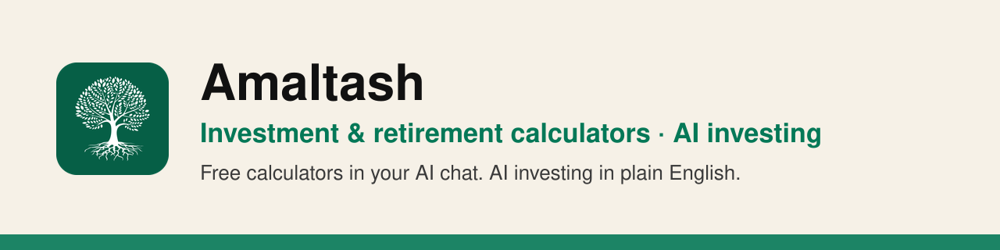
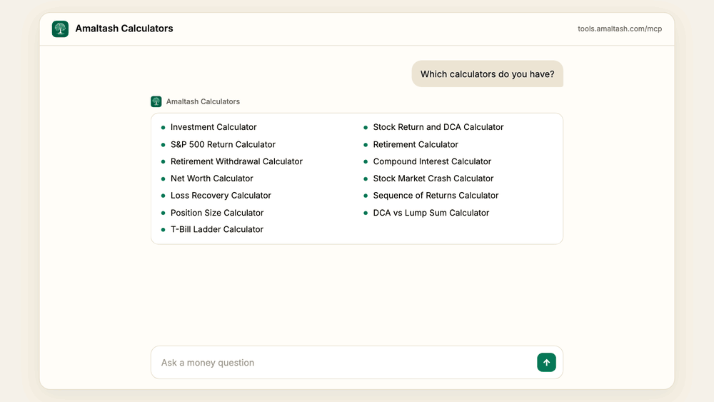
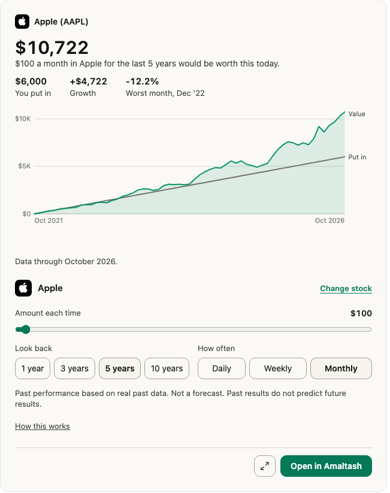
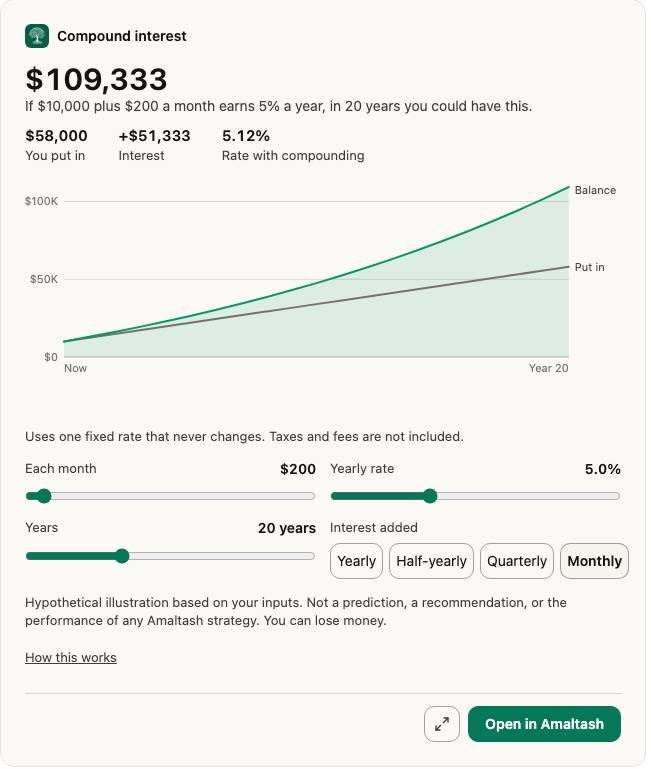
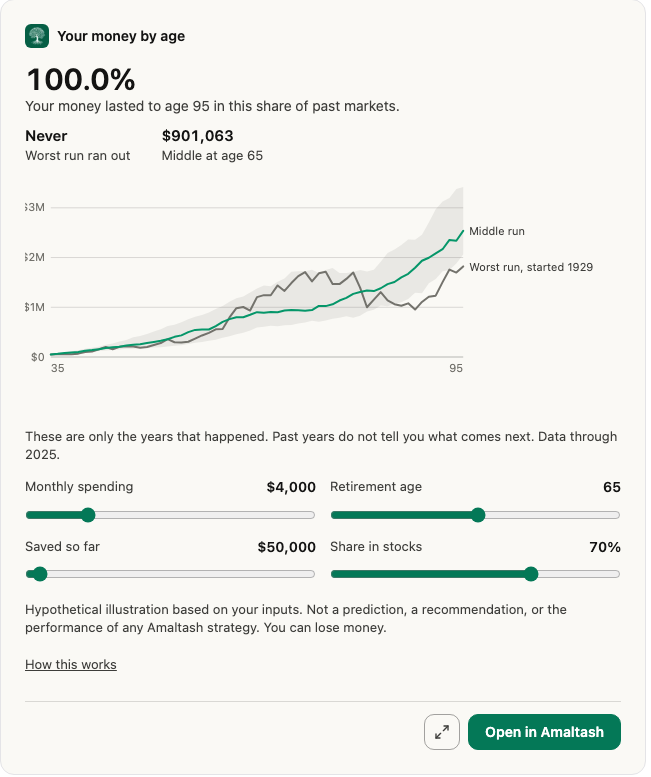

<!-- Org profile for github.com/amaltash-hq. Layout approved 2026-11-10 (AMA-10800). -->

<picture>
  <source media="(prefers-color-scheme: dark)" srcset="profile/banner-dark.svg">
  <source media="(prefers-color-scheme: light)" srcset="profile/banner-light.svg">
  
</picture>

# Amaltash: investment calculator, retirement calculator and AI investing

Ask a money question. Get the math and a chart you can change. Plus AI investing strategies in plain English.

[](https://registry.modelcontextprotocol.io/v0/servers?search=com.amaltash/calculators)
[](https://amaltash.com/mcp/calculators)
[](https://amaltash.com/mcp/calculators#data-heading)
[](https://amaltash.com/mcp/calculators)

## Get Amaltash

| Where | Link |
| --- | --- |
| Website | [amaltash.com](https://amaltash.com) |
| Web app | [trade.amaltash.com](https://trade.amaltash.com) |
| iPhone and iPad | [App Store](https://apps.apple.com/app/id6785155640) |
| Android | [Google Play](https://play.google.com/store/apps/details?id=com.amaltash.trade) |
| Calculators on the web | [amaltash.com/calculators](https://amaltash.com/calculators) |
| Calculators in AI chat | [Docs and examples](https://amaltash.com/mcp/calculators) |
| Claude Code plugins | [amaltash-hq/mcp](https://github.com/amaltash-hq/mcp) |

## See it work



## Calculators

<table>
  <tr>
    <td width="33%" valign="top">
      <a href="https://amaltash.com/mcp/calculators#stock-return-heading"></a><br>
      <b>Stock return and DCA.</b> 12,000+ US stocks and funds.<br>
      <a href="https://amaltash.com/mcp/calculators#stock-return-heading">Try it</a>
    </td>
    <td width="33%" valign="top">
      <a href="https://amaltash.com/mcp/calculators#compound-interest-heading"></a><br>
      <b>Compound interest.</b> Daily, monthly or yearly.<br>
      <a href="https://amaltash.com/mcp/calculators#compound-interest-heading">Try it</a>
    </td>
    <td width="33%" valign="top">
      <a href="https://amaltash.com/mcp/calculators#retirement-heading"></a><br>
      <b>Retirement.</b> Will my savings last?<br>
      <a href="https://amaltash.com/mcp/calculators#retirement-heading">Try it</a>
    </td>
  </tr>
</table>

And 10 more:

- [Investment calculator](https://amaltash.com/investment-calculator). See what a monthly amount could grow to.
- [Retirement withdrawal calculator](https://amaltash.com/mcp/calculators#retirement-heading). Test the 4% rule.
- [S&P 500 return calculator](https://amaltash.com/mcp/calculators#sp-500-heading). Replay real yearly returns since 1928.
- [DCA vs lump sum calculator](https://amaltash.com/mcp/calculators#dca-heading). Buy over time or all at once.
- [Net worth calculator](https://amaltash.com/mcp/calculators#net-worth-heading). Compare by age.
- [Loss recovery calculator](https://amaltash.com/mcp/calculators#risk-heading). What gain gets you back to even?
- [Stock market crash calculator](https://amaltash.com/mcp/calculators#risk-heading). See what a drop does to your money.
- [Sequence of returns calculator](https://amaltash.com/mcp/calculators#risk-heading). Why the order of good and bad years matters.
- [Position size calculator](https://amaltash.com/mcp/calculators#risk-heading). How much to put in one trade.
- [T-bill ladder calculator](https://amaltash.com/mcp/calculators#t-bill-heading). Spread cash across T-bills.

Saving in a CD or a savings account? Try the [CD calculator](https://amaltash.com/cd-calculator) or the [high-yield savings calculator](https://amaltash.com/high-yield-savings-calculator).

Every result says how it was worked out and what it assumes.

## Ask in your AI chat

- What does $10,000 grow to at 5% in 10 years?
- Can I retire at 60 with $800,000?
- What would $200 a month in VOO have become over 5 years?

## AI trading strategies

Amaltash uses AI to build Investing Strategies. Describe a trading idea in plain English. Amaltash turns it into clear rules you can read. Like algo trading, without writing code.

- **Test before you fund.** Each Strategy is backtested on years of market data. Backtested results are hypothetical. They don't promise future results.
- **You approve it.** You approve every Strategy before it goes live.
- **You set limits.** Each Strategy has limits, like a stop-loss. Limits help manage risk. They can't stop every loss.
- **What it covers.** US stocks, ETFs and crypto.

The trading plugin lets an AI assistant build and backtest Strategies and use paper trading. Real money needs a separate permission that you turn on. Each live Strategy waits for your approval. An assistant can never withdraw money.

Learn more at [amaltash.com](https://amaltash.com).

## For developers

- MCP server, no sign-in: `https://tools.amaltash.com/mcp`
- Plugins: [amaltash-hq/mcp](https://github.com/amaltash-hq/mcp)
- MCP Registry: [com.amaltash/calculators](https://registry.modelcontextprotocol.io/v0/servers?search=com.amaltash/calculators)
- Docs: [amaltash.com/mcp/calculators](https://amaltash.com/mcp/calculators)

Install in Claude Code:

```
/plugin marketplace add amaltash-hq/mcp
/plugin install calculators@amaltash
/plugin install trading@amaltash
```

Or add the calculator server with one command:

```bash
claude mcp add --transport http amaltash-calculators https://tools.amaltash.com/mcp
```

## FAQ

<details>
<summary><b>Is it free?</b></summary>

The calculators are free. The trading plugin needs an Amaltash account. See [pricing](https://amaltash.com/pricing).
</details>

<details>
<summary><b>Do I need an account?</b></summary>

Not for the calculators. You don't sign in, and they don't ask for personal data. The trading plugin asks you to sign in to Amaltash.
</details>

<details>
<summary><b>Where does the data come from?</b></summary>

Stock answers cover more than 12,000 US stocks and funds. That data updates nightly. S&P 500 and retirement math use yearly US returns since 1928, from NYU Stern. The net worth check uses the Federal Reserve's 2022 Survey of Consumer Finances.
</details>

<details>
<summary><b>Can the calculators trade or move my money?</b></summary>

No. They only do math. They can't trade or move money.
</details>

<details>
<summary><b>Which AI apps does it work with?</b></summary>

Claude today, with the plugins above. ChatGPT and Google once they are approved. Any AI app that supports MCP can add the calculator server at `https://tools.amaltash.com/mcp`.
</details>

<details>
<summary><b>Is this investment advice?</b></summary>

No. Read the note below.
</details>

<details>
<summary><b>Who makes Amaltash?</b></summary>

Amaltash Advisors LLC.
</details>

## Important

Results are for education only. They are not investment advice or a promise of future results. Projections are hypothetical. Past results don't predict future ones. You can lose money.

[Privacy](https://amaltash.com/policies/privacy#calculators-connector) · [Contact](https://amaltash.com/contact) · [Security](https://github.com/amaltash-hq/.github/blob/main/SECURITY.md)

---

This repository holds the Amaltash organization profile. The page you see at [github.com/amaltash-hq](https://github.com/amaltash-hq) comes from `profile/README.md`. Keep this file in step with it.
